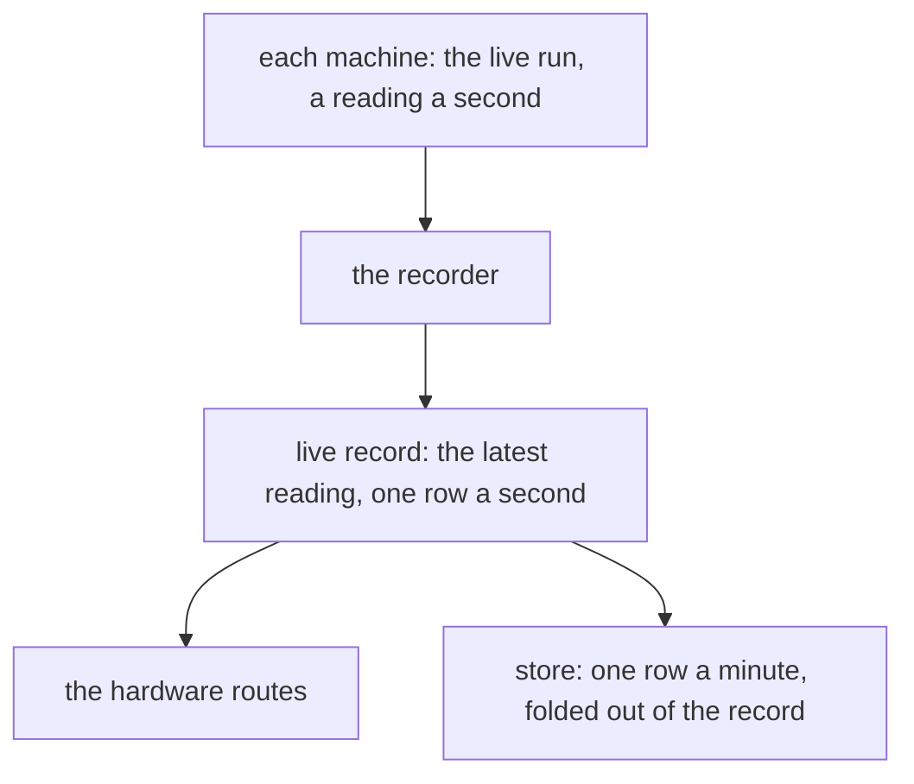

# Hardware monitor

Every machine's hardware: this one and every node of the list (`docs/nodes.md`). Each machine is read by
the same probe over its own road, and every reading is described the same way: one group per piece of
hardware (the CPU with its chip laid out as it physically stands, each GPU, memory, every storage device,
the board), each carrying its own use, capacity, temperature and power, so the piece at fault is the one
that shows it. Every tracked machine is read live, once a second, and kept for a month. A screen draws
what this service answers (`docs/api.md`, 「Hardware」).

## Which machines

- **This machine,** named `local`, read with a local shell.
- **Every node of the list,** in the list's order, and nothing else. The monitor keeps no list of its own.
  - An ssh node is read by logging in the way its check does (batch mode, the node's key alone, the host
    key held to) and running the probe there, in the language the node's login answers in.
  - A jake node is read by handing the probe to its hub's `POST /exec?agent=<agent>` as a `linux` shell
    command, with the control token read out of the hub's token file for that one request. Each jake agent
    is a machine of its own; the hub is never read or shown as one.
- The same road runs any other shell script the monitor hands a machine; the Windows setup below is one.
- **A machine is shown once.** A node that is this machine (`docs/nodes.md`, 「This machine」) carries
  `thisMachine`, and a screen folds it into this machine's tile, since the local reading is the same
  probe on the same machine.

## The probe

- **One POSIX shell script, the same on every machine and every road that takes a POSIX shell.** It prints
  sections, each headed by a line `@@<name>`, and every figure is taken out of its output by one parser. A
  section the machine does not have is empty or missing, and the parser reads that as not readable.
- A node whose login answers in Windows PowerShell is read by the Windows probe, which prints sections
  the same parser reads (「A Windows machine」).
- **It runs in two forms, made of the same sections:** once, one reading and done, which is how a machine
  is read where the recorder has nothing fresh of it (「How often」); and live, one run that stays open
  over the machine's road and prints a reading every second (「Live」).
- **The scripts stand written in this repository** and the recorder embeds them: two POSIX live scripts,
  one lasting four minutes and one an hour, and the PowerShell live script.
- **The probe's fixtures** stand beside the tests: each a probe output, from a test sample or a real
  machine, with the readings the parser makes of it written beside it. The parity test reads every output
  and fails where a reading differs from the one written.
- What it reads:
  - host name, kernel release, whether the kernel is WSL's, and the distribution's name and version from
    os-release;
  - `/proc/uptime`, `/proc/loadavg`, the four totals of `/proc/meminfo` the monitor shows (memory and swap,
    total and available), the CPU model out of `/proc/cpuinfo`;
  - each logical CPU's package, core, the set of CPUs its L3 is shared with, and its current clock from
    cpufreq;
  - `/proc/stat` twice, which each CPU's use is worked out from: half a second apart in the probe run once,
    one reading apart in the live run;
  - the package energy counter of the powercap interface, twice across the same stretch, which CPU power is
    worked out from, read directly or through `sudo -n` where the account may use sudo without a password
    and the counter is root's alone;
  - every hwmon chip's temperatures and fans, with their labels and the device each chip belongs to, and for
    each temperature the critical and the highest one the chip names for it (「Temperature limits」);
  - `nvidia-smi`, on the path or where WSL puts it, for each NVIDIA GPU's use, clocks, temperature, power,
    memory and fan, and whether thermal slowdown is holding its clocks down; and its whole report as XML,
    where the temperature each GPU slows down at stands, read in a live run's first reading alone;
  - the block devices from `lsblk`, the sysfs device each disk stands on, and from `df` each mounted file
    system a volume can be, asked one at a time and given a few seconds each, so a mount that stopped
    answering costs only its own figures;
  - on WSL, the Windows side (below);
  - the running and failed services of systemd, the system's and the account's own.
- **A value that cannot be read is null, never nought.** In particular:
  - a CPU's clock is read from cpufreq; where there is none, `/proc/cpuinfo` on a machine that is not WSL,
    and on WSL the Windows side's;
  - CPU power is unreadable where the energy counter is missing; where it refuses the account and sudo is
    not open to it, the power is the code `denied`;
  - a board input nothing is wired to reads nought, -128 or a byte's top; a temperature at or below nought
    or at 127 °C and above is no temperature and is left out.
- A machine that cannot be reached at all (the login refused, the agent not attached, the probe running
  past its limit) answers a failure with what was met, and none of its figures.

## The Windows side

- **On WSL the machine's own figures are read from the Windows it runs on,** since WSL sees a virtual
  machine with the VM's own load, its share of memory, fixed clocks and no sensors. The probe hands a
  PowerShell script, as one encoded command, to the Windows PowerShell under `/mnt/c`, and what it answers
  stands in place of the virtual machine's figures:
  - every logical processor's use and effective clock from the performance counters, in Windows' own order;
  - package power from the Energy Meter counter, or the sensor library's own package power where there is
    no such counter;
  - memory and uptime from the operating system, and its edition and build;
  - each physical disk with its bus, medium and size, and the lettered volumes on it;
  - the CPU's temperatures, the board chip's temperatures and fans, and each disk's temperature, from
    LibreHardwareMonitor, the CPU's sensors given the names the kernel's own drivers use (`Tctl`,
    `Tccd<n>`, `Package id 0`, `Core <n>`), and a figure the library works out from others left out.
- The load average and the services stay the WSL side's, and the WSL virtual disk stays one of the
  machine's storage devices.
- **In the live run the Windows side stays open too:** one PowerShell runs for the whole live run, opens
  the counters and the library once, then prints a block every second, which paces the run. The edition,
  the boot time and the disks and volumes are asked again every thirty readings.
- **LibreHardwareMonitor and its driver are the monitor's own setup on each Windows machine.** The
  library's release is unpacked under `%ProgramData%` and reads the CPU and the board through the PawnIO
  driver, installed with winget; the place, the release and the driver package are the policy's
  `windows-sensors.toml`, which the sensor script and the setup both read.
- **`bmo-node hardware-setup [<node>…]`** puts both in place on the Windows of each node named, or of every
  node: under a WSL node, or a Windows node itself. Run again it changes nothing already in place, and a
  node with no Windows is left alone. It is done only where both the library and the driver answered. A
  machine without the library still has every figure the performance counters give, and its board says
  the library is missing.

## A Windows machine

- **A node whose login answers in Windows PowerShell is read by the Windows probe,** with no WSL in between.
- **The road hands the probe to Windows PowerShell as one encoded command** over the node's own login:
  nothing is written on the machine.
- **It prints the sections the parser reads:** a head saying the reading is a Windows machine's, the host
  name and, in the live form, the uptime each reading was taken at; every record of 「The Windows side」;
  the edition with its build and kernel version, the CPU's model with its cores and logical processors,
  and the page file's size and use as the swap; each NVIDIA GPU in the columns the POSIX probe takes from
  `nvidia-smi`, and the temperature it slows down at.
- **Every GPU figure comes from NVML called inside the probe's own PowerShell,** opened once per run and
  asked each reading, never from a process started per reading. Where the driver's library is missing the
  GPUs are unreadable.
- **What Windows does not have is unreadable:** the load average and systemd's services.
- **The chip is drawn from the CPU's model and its counts:** Windows numbers a core's logical processors
  next to each other, so each logical processor's core is its place divided by the threads per core.
- **A Windows machine's login is the node's own setup,** a Windows OpenSSH server whose login shell is
  Windows PowerShell, on a port of its own. Until that login is open the node is unreadable, and its
  failure says what the login met.

## Storage

- **Every storage device is its own piece of hardware,** never a total: its model, its kind (`nvme`, `ssd`,
  `hdd`, `usb`, the WSL virtual disk, a network share), its size, each volume on it with its used and total
  space, and its own temperature where it has one.
- On Linux a mount is hung on the disk it stands on by following `lsblk`'s parents, and a bind mount of a
  source already shown is not shown again. A disk connected with nothing mounted is still listed. The
  kernel's own file systems and loop devices are not storage.
- A network share (NFS, SMB, an rclone or sshfs mount) is a device of its own, named by its source.
- A drive's temperature is its own hwmon chip's (`nvme`, `drivetemp`), matched by the sysfs device the chip
  and the disk share; the composite reading where a drive reports several.
- On WSL the Windows disks are the machine's drives, and the Linux side contributes only the virtual disk.

## How often

- **One period, a second, paces everything live:** how often each machine is read, and how far apart two
  readings may stand before a line breaks.
- **The recorder is the one reader.** It keeps every tracked machine's live run open whether a screen is
  open or not, so a machine is read once a second however many screens show it, and a machine whose
  tracking is off is not read at all (「Tracking」).
- **`GET /hardware/{machine}` answers the recorder's latest reading** of the machine. Where the recorder
  has nothing fresh of a tracked machine, no reading or failure within ten seconds, the service reads it
  itself with the probe run once, keeps that reading for one period and joins a read already under way, so
  several askers at once cost the machine one probe.
- A probe run once that has not finished in twenty seconds is given up and answered as a failure.

## Units

- **Every figure is kept in its physical unit:** memory, VRAM and storage in GB, power in W, temperature in
  °C, clock in MHz, a fan in RPM. A use, and a GPU fan, are shares.
- Memory, VRAM and a volume are counted in binary gigabytes, the way the machine reports them; a drive's
  own size is its maker's, in decimal units.

## History

- **Every figure is named by the piece of hardware it belongs to and what it measures,** `<piece>|<metric>`:
  the metric is `use`, `temp`, `watts`, `mhz`, `gb` or `rpm`, and the piece `cpu`, `memory`, `gpu<n>`,
  `gpu<n>:vram`, `storage:<key>` or `fan:<chip>:<label>`. A figure is kept to a tenth, a store to a
  hundredth of a gigabyte. The live record and the history use the same names.
- **Every closed minute is folded out of the live record** into `hardware_samples`, once a minute: one row
  per machine per minute holding each figure's lowest, highest, sum and count across that minute's
  readings, under the minute's start. A machine is never read a second time for its history. Each pass
  folds the minutes that closed since the machine's last row, as far back as the live record reaches.
- A figure that was not read is left out of its row, and a minute with no reading leaves a gap.
- **Every closed half hour is rolled up** into `hardware_rollups` the same way, a bounded number at a time,
  so a month of passes with no rollups is taken in over the passes that follow.
- **How long a row is kept:** a minute's row for two days, and only once its half hour has been rolled up;
  a half hour's row for thirty-one days. Each pass removes what has grown older.
- **A span is asked by name,** each cut into points of a fixed width:

  | Span | Point | Drawn out of |
  |---|---|---|
  | `5m` | 5 seconds | the live record |
  | `15m` | 15 seconds | the live record |
  | `1h` | 1 minute | the minutes' rows |
  | `6h` | 5 minutes | the minutes' rows |
  | `24h` | 5 minutes | the minutes' rows |
  | `7d` | 30 minutes | the half hours' rows |
  | `30d` | 2 hours | the half hours' rows |

  - The half hour not yet rolled up is read from the minutes' rows, so a week's or a month's last point is
    as fresh as the day's.
  - Each point carries the figure's lowest, highest and mean over it; a point nothing was recorded in
    carries none.

## Live

- **The recorder holds one live run open per tracked machine,** this one and every tracked node, and reads
  the list again every minute, starting a run for a node added and stopping the run of one removed.
  - Each reading carries the whole machine; the parts that hardly change (the host and OS, the CPU's model
    and layout, the block devices, the mounts and the services) are read again only every thirty readings,
    and the recorder lays the last of them under each reading in between.
  - Use and power are worked out between one reading and the one before, across the time the machine
    itself says passed; a run's first reading only sets the start.
  - **A reading's second is counted along the machine's own clock** from the second this machine saw the
    run's first reading at. A count that strays more than five seconds from this machine's clock starts
    again from now.
  - **A run lasts a set time and is relieved before it ends:** the next run starts twenty seconds ahead
    and takes over at its first reading. Its length is the road's: four minutes through a jake hub, which
    stops an exec at five; an hour on a local shell or an ssh login.
  - A run that ends early, fails or stays silent for thirty seconds is stopped, the machine's latest
    becomes the failure with what was met, and a run starts again after a wait that grows from a second to
    thirty while the failures go on.
- **The live record** is a SQLite file of its own, `hardware-live.db`, written by the recorder alone, on a
  thread of its own, since a commit waits on the disk and a reading lands every second. The service reads
  it over a connection that only reads.
  - It holds each machine's latest reading in full, or the failure its run met, with the second it came;
    and one row per machine per second, holding that reading's figures under the names of 「History」.
- **How much is kept:** fifteen minutes back, and at most 16 KB for every second of that reach. Each
  minute's pass folds the closed minutes first, then removes the rows older than the reach, then the
  oldest beyond the size.

## Tracking

- **Every machine's live tracking is a switch, on unless it was turned off,** kept per machine as the
  setting `hardware_tracking:<machine>`. A machine with no setting is tracked, and a setting left by a node
  since removed reads nothing.
- **Off means the machine is not read at all:** the recorder stops its live run, nothing is added to the
  live record, and `GET /hardware/{machine}` answers it as not tracked instead of reading it.
- **The minute rows stop with it,** so a machine whose tracking is off leaves a gap in its history.
- **`PUT /hardware/{machine}/tracking` moves the switch;** the recorder follows it at once, and every minute's pass
  reads the settings again as well.

## The chip

- **The chip is described as it physically stands:** the dies where they sit on the package, and inside
  each die the cores, the caches and the rest in their places, each part with an English name a screen
  may word in its own language.
- The CPU model decides the layout, and the machine's own topology decides how many of each part:
  - **AMD Zen 2 desktop** (Ryzen 3000 without a G): up to two CCDs side by side above the I/O die, each
    holding two CCXs, one above the other, half the cores left of the L3 and half right.
  - **AMD Zen 3 desktop** (Ryzen 5000 without a G): the same package; each CCD is one CCX, half its cores
    left of the L3 and half right.
  - **Intel Core with a ring and no efficiency cores** (up to the 10th generation): one die, the GPU on the
    left (switched off on an F part), the cores stacked each beside its slice of the LLC, and the system
    agent on the right.
  - **Anything else:** one die, the cores grouped by the L3 they share.
- Which physical core a logical CPU is cannot be read, so the cores fill the places in the order of their
  core numbers.
- A sensor that names a die is placed on it: AMD's `Tccd<n>` on CCD n-1, `Tctl` on the package, Intel's
  `Package id` on the die and `Core <n>` on core n.

## Temperature limits

- **Each part's temperature carries that part's own limit,** the temperature it starts to slow itself down
  at:
  - a GPU: the temperature its driver says it slows down at, and whether thermal slowdown is holding its
    clocks down;
  - a hwmon temperature: the critical temperature its chip names, or the highest where it names no
    critical one;
  - a CPU whose chip names none (AMD's `k10temp`, a Windows machine's sensor library): the limit set for
    that machine.
- **A machine's CPU limit is the setting `hardware_cpu_limit:<machine>`,** moved by `PUT
  /hardware/{machine}/cpu-limit`. A limit set stands over the one the chip names, and the reading says which of the
  two it is. With neither, the CPU's temperature has no limit.
- **No limit of any part stands in the code.**
