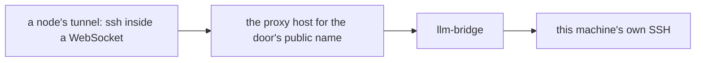

# The tunnel door

`llm-bridge` is the door a node's tunnel comes in by. A node on a network that lets only HTTPS out cannot
open an SSH connection to the machine its service's callers run on, so the node dials that machine over
HTTPS and its SSH rides inside a WebSocket. The door takes the WebSocket and pipes it to the machine's
own SSH.

## What it does

- **It listens on one port on every interface** and takes a WebSocket only when its bearer is the key of a
  service named in the door's list; it then pipes the connection both ways to SSH on `127.0.0.1:22`.
  Anything else is refused before a byte reaches SSH.
- **A refusal says nothing more:** a request without a listed key is answered `401` with `unauthorized`,
  and one with a listed key that is no WebSocket `426` with `upgrade required`.
- **The key is compared in constant time,** so how long a refusal takes says nothing of how much of a key
  a caller had right.
- **What a tunnel sends before SSH answers** waits on the WebSocket and is carried once the connection to
  SSH stands. Either end closing ends the other.
- **The door's list** is `$BMO_DATA_DIR/env/tunnel-door.keys`: one key file's path to a line, each a
  service's own key, which that service's installer adds. The door reads the list and every key file in it
  for each connection, so a key added or taken out counts from the next connection with no restart, and a
  key file that is missing, empty or not `0600` admits nothing.
- **A key appears nowhere else:** no log line, answer or unit file.

## Its settings

- `LLM_BRIDGE_LISTEN` moves the listen, and `LLM_BRIDGE_TARGET` what it pipes to, for a test standing an
  echo in place of SSH. A port of 0 is one the system chooses, named in the line the door prints as it
  starts listening.
- `BMO_DATA_DIR` names the data root the door's list is read under, `~/.local/share/bmo/data` where it is
  unset.
- Each setting is also a flag of the same name (`--listen`, `--target`, `--data-root`), and the flag
  stands over the variable.

## Where it stands

- **The unit is `bmo-llm-bridge.service`,** this repository's `deploy/bmo-llm-bridge.service`, running the
  release's `bin/llm-bridge`. It is marked `binary`: a deployment restarts it only where the binary
  changed.
- **The way in is the door's own,** set up on the machine the door runs on: a public name whose record
  reaches the proxy, a proxy host for that name with WebSocket upgrade on and long read and send timeouts
  forwarding to the door's port, and the machine's firewall opening that port to the proxy's address
  alone.
- **The far end of each tunnel** is one entry in the machine's account's `authorized_keys` for the node's
  tunnel key, allowing nothing but port forwarding, letting the key listen only on the node's own listen,
  and forcing `nologin` as its command. What answers on the public name is the door, and what the door
  reaches is SSH, which still asks for the node's tunnel key.

## Its check

`tests/llm_bridge` starts the binary on a port the system chooses, reads the port from the line it prints,
and asks it over a TCP echo; the key comparison is held to constant time by a test of its own.
